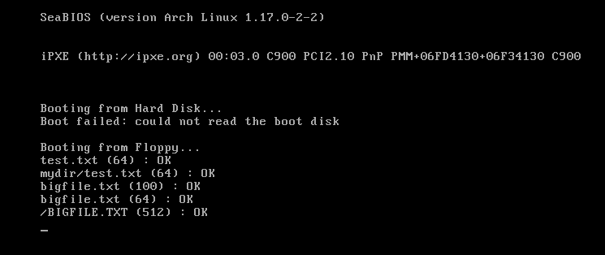
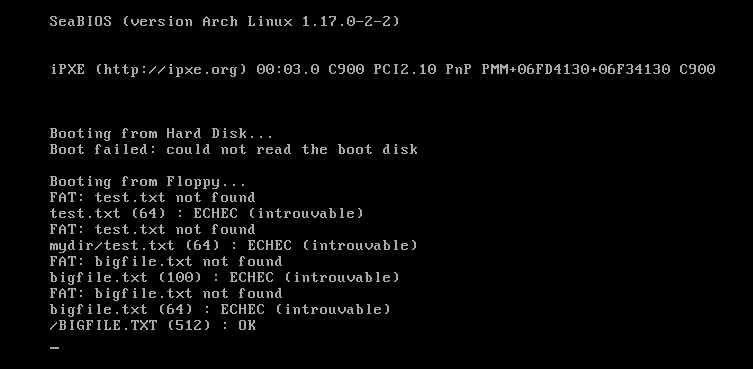
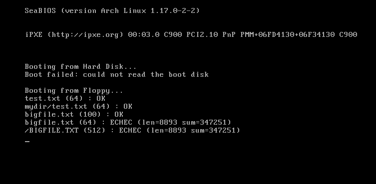
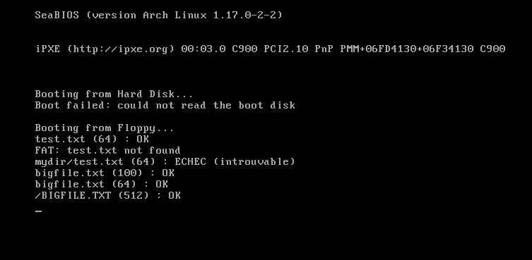
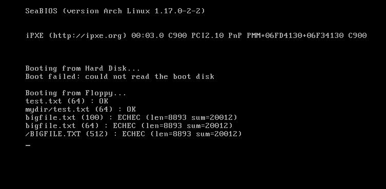

# Jour 10 : apprendre à déboguer (le laboratoire de bugs) / Day 10: Learning to Debug (the Bug Lab)

[Version Française](#french) | [English Version](#english)

---

##  🇫🇷 Version Française

### Objectif

Apprendre à trouver un bug dans du code de système d'exploitation : on casse le pilote FAT exprès, un bug à la fois, on observe le symptôme, on cherche la cause avec les bons outils, puis on corrige.

### Résultat

Sans bug, le programme de test affiche `OK` pour les 5 lectures : `test.txt`, `mydir/test.txt`, `bigfile.txt` par morceaux de 100 et de 64 octets, et `/BIGFILE.TXT` par morceaux de 512.

### Ce que j'ai compris

#### Pourquoi apprendre à déboguer
Dans la vidéo, l'auteur a passé environ 3 heures à trouver les bugs du pilote FAT. Quand on écrit un système d'exploitation, rien ne se passe comme prévu, et on ne dispose ni d'un débogueur intégré ni de messages d'erreur clairs. La méthode compte donc autant que le code.

#### Les trois techniques de la vidéo
1. **Afficher des valeurs avec `printf`** pendant que l'OS tourne.
2. **Le pas à pas** avec un débogueur (Bochs, ou QEMU avec `gdb`).
3. **Sortir le code sur le PC** et le déboguer avec les outils habituels.

#### Mon pilote FAT sur le PC (`fathost`)
`make` compile aussi `build/tools/fathost`. C'est **le même fichier `fat.c`** que celui de la stage 2, mais compilé par `gcc` sur mon PC. Pour cela : des en-têtes de remplacement (`tools/fathost/shim/`) fournissent `disk.h` (lecture dans un fichier image au lieu d'un vrai disque) et `memdefs.h` (un tableau au lieu d'une adresse mémoire), et deux options de compilation suppriment les mots-clés propres à Open Watcom : `-Dfar=` et `-D_cdecl=`. Usage : `./build/tools/fathost build/main_floppy.img test.txt mydir bigfile.txt`. Sur le PC, je peux utiliser `gdb`, afficher ce que je veux et comparer avec l'OS.

#### Sa limite
Le PC ne reproduit pas les bugs propres au mode 16 bits (par exemple, mélanger pointeurs near et far). Un bug qui **réussit sur le PC mais échoue dans l'OS** est un indice : il vient de la différence entre les deux (taille des types, segments).

#### Ma méthode
1. **Reproduire** le bug avec un test précis (les tests affichent `OK` ou `ECHEC`).
2. **Réduire** : trouver le plus petit cas qui échoue (quel fichier, quelle taille de morceau).
3. **Comparer** l'OS et le PC : même résultat ou pas ?
4. **Localiser** : `printf` ou `gdb` pour voir les valeurs, `hexdump`, `mshowfat` et `xp` dans le moniteur QEMU pour voir les vraies données.
5. **Corriger**, puis **relancer tous les tests**, pas seulement celui qui échouait.

#### Les tests avec valeurs attendues
`main.c` lit des fichiers par morceaux de tailles différentes et compare la longueur et la **somme des octets** avec des valeurs calculées à l'avance sur le PC. Un résultat `OK` prouve que le fichier est lu en entier et sans erreur.

### Le laboratoire de bugs

Avant de commencer : `git add . && git commit` (pour pouvoir revenir en arrière). Commandes : `tools/bug.sh list` (liste les bugs), `tools/bug.sh N` (introduit le bug N), `tools/bug.sh restore` (remet le fichier d'origine). Après chaque bug : `make`, puis `make run` (OS) et `./build/tools/fathost build/main_floppy.img ...` (PC).

#### Bug 1 : l'extension n'est pas en majuscules
- **Symptôme dans l'OS :** quatre tests sur cinq échouent avec `FAT: ... not found` puis `ECHEC (introuvable)` : `test.txt`, `mydir/test.txt` et `bigfile.txt` (aux deux tailles de morceau). Seul `/BIGFILE.TXT (512)` réussit.

- **Ce que je remarque :** les noms écrits **en minuscules** échouent, et celui écrit **en majuscules** (`/BIGFILE.TXT`) réussit. Les noms FAT sont en majuscules sur le disque, donc le défaut est dans la façon dont le nom que je tape est converti avant d'être comparé.
- **Symptôme sur le PC :** `./build/tools/fathost build/main_floppy.img test.txt /TEST.TXT mydir/test.txt` donne `test.txt : introuvable`, mais `/TEST.TXT` est trouvé (`len=52 sum=4487`), et `mydir/test.txt : introuvable`. C'est le même comportement que dans l'OS : le bug vient de la logique en C, pas du mode 16 bits.
- **Comment je l'ai trouvé :** J'ai affiché le nom converti avec `printf("nom FAT : [%s]\r\n", fatName);` juste avant la boucle de `FAT_FindFile`. Avec le bug, `bigfile.txt` donne `[BIGFILE txt]`, alors que `/BIGFILE.TXT` donne `[BIGFILE TXT]`, et le nom sur le disque est `BIGFILE TXT`. En comparant caractère par caractère, seule la **casse de l'extension** diffère. (Ma capture de référence, sans bug, montre `[TEST    TXT]`.) La commande `bash tools/bug.sh 1` affiche aussi la ligne modifiée.
- **Cause :** La ligne `fatName[8 + i] = dot[1 + i];` copie l'extension telle qu'elle est tapée (en minuscules), alors que le nom passe par `toupper`. `memcmp` compare 11 octets exacts : `t` (0x74) est différent de `T` (0x54), donc aucune entrée ne correspond.
- **Correction :** Remettre `fatName[8 + i] = toupper(dot[1 + i]);`.

#### Bug 2 : le tampon n'est pas rechargé quand il est vidé pile
- **Symptôme dans l'OS (quels morceaux échouent, lesquels réussissent ?) :** `test.txt`, `mydir/test.txt` et `bigfile.txt` lu par morceaux de 100 octets : `OK`. `bigfile.txt` par morceaux de 64 et `/BIGFILE.TXT` par morceaux de 512 : `ECHEC (len=8893 sum=347251)`. La **longueur est bonne** (8893), mais la **somme des octets est fausse** : le contenu est corrompu.

- **Symptôme sur le PC :** `FATHOST_CHUNK=100` donne `len=8893 sum=378866` (correct). `FATHOST_CHUNK=64` et `FATHOST_CHUNK=512` donnent `len=8893 sum=347251` (faux), exactement la même somme fausse que dans l'OS. C'est donc un bug de logique, indépendant du mode 16 bits.
- **Comment je l'ai trouvé :** J'ai comparé les tailles de morceau : 64 et 512 échouent, 100 réussit. 64 et 512 divisent 512, la taille d'un secteur : une lecture finit alors **exactement à la fin d'un secteur**. Avec 100, ça n'arrive jamais ici (le plus petit multiple commun de 100 et 512 est 12800, plus grand que le fichier de 8893 octets). Ça m'a mené à la condition qui recharge le tampon dans `FAT_Read`.
- **Cause :** `if (byteCount > 0)` ne recharge le secteur suivant que s'il reste des octets à lire dans cet appel. Quand une lecture vide le tampon pile (`leftInBuffer == take`), `byteCount` vaut 0 : pas de rechargement. L'appel suivant recopie alors des octets du tampon resté sur le secteur précédent : la longueur est bonne, mais le contenu est faux. Le même défaut casse aussi la lecture du répertoire racine au-delà de son premier secteur (avec 40 fichiers, `f40.txt` n'est plus trouvé).
- **Correction :** Remettre `if (leftInBuffer == take)` : on recharge quand le tampon est épuisé, pas quand il reste des octets demandés.

#### Bug 3 : on interdit la lecture d'un sous-dossier
- **Symptôme dans l'OS :** `test.txt` et les trois lectures de `bigfile.txt` sont `OK`. Mais `mydir/test.txt` échoue : le pilote affiche `FAT: test.txt not found`, puis le test affiche `ECHEC (introuvable)`. Le message ne dit pas que `mydir` est introuvable : c'est `test.txt` qui n'est pas trouvé **à l'intérieur** de `mydir`.

- **Symptôme sur le PC :** `./build/tools/fathost build/main_floppy.img mydir mydir/test.txt` affiche `mydir :` suivi d'une **liste vide** (sans le bug, on voit `.`, `..` et `TEST    TXT`), puis `FAT: test.txt not found` et `mydir/test.txt : introuvable`.
- **Comment je l'ai trouvé :** Sur le PC, lister `mydir` ne donne aucune entrée : `FAT_ReadEntry` échoue dès la première lecture, donc `FAT_Read` rend 0 octet. J'ai relu le début de `FAT_Read` : le nombre d'octets est limité à `Size - Position`. Or, dans FAT, un sous-dossier a une taille de **0** dans son entrée.
- **Cause (indice : quelle est la taille d'un sous-dossier dans sa propre entrée ?) :** `if (1)` applique toujours la limitation `byteCount = minimum(byteCount, Size - Position)`, même aux dossiers. Pour un sous-dossier, `Size` vaut 0, donc 0 octet peut être lu. Le test d'origine saute cette limitation pour un dossier dont la taille est 0, et le lit jusqu'à la fin de sa chaîne de clusters.
- **Correction :** Remettre `if (!fd->Public.IsDirectory || (fd->Public.IsDirectory && fd->Public.Size != 0))`.

#### Bug 4 : la table FAT est lue avec un pointeur near au lieu de far
- **Symptôme dans l'OS :** `test.txt` et `mydir/test.txt` (de petits fichiers) sont `OK`. `bigfile.txt` échoue aux trois tailles de morceau avec **la même somme fausse** : `ECHEC (len=8893 sum=20012)`.

- **Symptôme sur le PC :** `test.txt` est lu correctement, puis le programme s'arrête avec `Segmentation fault` dès qu'il lit `bigfile.txt`. Dans l'OS, il n'y a pas de plantage : une mauvaise somme (`sum=20012`).
- **Pourquoi la différence entre l'OS et le PC :** En mode réel 16 bits, un pointeur **far** est un couple segment:offset. Le convertir en `uint16_t` ne garde que l'offset, et le pointeur **near** obtenu utilise le segment de données courant (celui de la stage 2, `0x2000`) au lieu du segment `0x0050` où se trouve la table FAT : on lit des octets valides, mais au mauvais endroit, donc un mauvais numéro de cluster, donc un contenu faux, sans plantage. Sur le PC, les pointeurs font 64 bits : les tronquer à 16 bits donne une adresse minuscule et invalide, d'où un plantage immédiat. Le même défaut, deux symptômes.
- **Cause :** Dans `FAT_NextCluster`, les deux lignes `(*(uint16_t*) (uint16_t) (g_Fat + fatIndex))` convertissent le pointeur far `g_Fat` en entier de 16 bits, puis en pointeur near. Seuls les fichiers de plus d'un cluster (plus de 512 octets) ont besoin de la table FAT, d'où `test.txt` correct et `bigfile.txt` faux. La somme fausse est la même pour toutes les tailles de morceau, puisqu'on lit toujours au même mauvais endroit.
- **Correction :** Remettre `*(uint16_t far*) (g_Fat + fatIndex)` : garder le mot `far`.

#### Bug 5 : la racine n'est pas rechargée à chaque ouverture (plus de 16 fichiers)
- **Préparation :** ajouter 40 fichiers à l'image après `make` : `for i in $(seq 1 40); do echo "fichier $i" > /tmp/f$i.txt; mcopy -i build/main_floppy.img /tmp/f$i.txt ::f$i.txt; done`
- **Test sur le PC :** `./build/tools/fathost build/main_floppy.img f40.txt test.txt`
- **Symptôme :** Sur le PC, `./build/tools/fathost build/main_floppy.img f40.txt test.txt` trouve `f40.txt` (`len=29`), puis affiche `FAT: test.txt not found` pour `test.txt`. Pourtant `test.txt` seul est trouvé : le résultat dépend de la recherche précédente.
- **Cause :** La racine garde un tampon d'un secteur. Chercher `f40.txt`, qui se trouve dans un secteur plus loin (la racine a plus de 16 entrées), laisse le tampon sur ce secteur. Sans rechargement, l'ouverture suivante remet seulement la position à 0 et relit les entrées depuis ce tampon, pas depuis le début de la racine : `test.txt` (dans le premier secteur) n'est pas vu. Avec 16 fichiers ou moins, la racine tient dans un seul secteur et le bug ne se voit pas.
- **Correction :** Remettre `if (!FAT_RewindRootDirectory(disk))`, qui remet la position et le cluster au début et **relit le premier secteur de la racine**.

### Erreurs rencontrées

| Erreur / symptôme | Cause | Solution |
|-------------------|-------|----------|
| Le bug que je viens d'introduire n'a aucun effet côté PC | `make run` ne recompile pas `fathost` (seulement l'OS) | lancer `make` (sans `run`) pour recompiler aussi `fathost` |
| Le dépôt contient un `fat.c` cassé après le laboratoire | j'ai oublié `bash tools/bug.sh restore` avant le commit | toujours faire `bash tools/bug.sh restore`, puis `make run` (5 lignes `OK`), puis `git add` et `git commit` |

---

##  🇬🇧 English Version

### Goal

Learn how to find a bug in operating system code: we break the FAT driver on purpose, one bug at a time, observe the symptom, look for the cause with the right tools, then fix it.

### Result

Without a bug, the test program prints `OK` for the 5 reads: `test.txt`, `mydir/test.txt`, `bigfile.txt` in chunks of 100 and 64 bytes, and `/BIGFILE.TXT` in chunks of 512.

### What I understood

#### Why learn to debug
In the video, the author spent about 3 hours finding the FAT driver's bugs. When writing an operating system, nothing goes as planned, and there is no built-in debugger or clear error message. So the method matters as much as the code.

#### The three techniques from the video
1. **Print values with `printf`** while the OS runs.
2. **Step-by-step** with a debugger (Bochs, or QEMU with `gdb`).
3. **Take the code out to the PC** and debug it with the usual tools.

#### My FAT driver on the PC (`fathost`)
`make` also builds `build/tools/fathost`. It is **the same `fat.c` file** as in stage 2, but compiled by `gcc` on my PC. To do that: replacement headers (`tools/fathost/shim/`) provide `disk.h` (reading from an image file instead of a real disk) and `memdefs.h` (an array instead of a memory address), and two compile options remove Open Watcom-specific keywords: `-Dfar=` and `-D_cdecl=`. Usage: `./build/tools/fathost build/main_floppy.img test.txt mydir bigfile.txt`. On the PC, I can use `gdb`, print whatever I want and compare with the OS.

#### Its limit
The PC does not reproduce bugs specific to 16-bit mode (for example, mixing near and far pointers). A bug that **succeeds on the PC but fails in the OS** is a clue: it comes from the difference between the two (type sizes, segments).

#### My method
1. **Reproduce** the bug with a precise test (the tests print `OK` or `ECHEC`).
2. **Reduce**: find the smallest case that fails (which file, which chunk size).
3. **Compare** the OS and the PC: same result or not?
4. **Locate**: `printf` or `gdb` to see the values, `hexdump`, `mshowfat` and `xp` in the QEMU monitor to see the real data.
5. **Fix**, then **rerun all the tests**, not only the one that failed.

#### Tests with expected values
`main.c` reads files in chunks of different sizes and compares the length and the **sum of the bytes** with values computed beforehand on the PC. An `OK` result proves the file is read completely and without error.

### The bug lab

Before starting: `git add . && git commit` (so I can go back). Commands: `tools/bug.sh list` (lists the bugs), `tools/bug.sh N` (introduces bug N), `tools/bug.sh restore` (puts the original file back). After each bug: `make`, then `make run` (OS) and `./build/tools/fathost build/main_floppy.img ...` (PC).

#### Bug 1: the extension is not uppercased
- **Symptom in the OS:** four tests out of five fail with `FAT: ... not found` then `ECHEC (introuvable)`: `test.txt`, `mydir/test.txt` and `bigfile.txt` (at both chunk sizes). Only `/BIGFILE.TXT (512)` succeeds.

- **What I notice:** names typed in **lowercase** fail, and the one typed in **uppercase** (`/BIGFILE.TXT`) succeeds. FAT names are uppercase on the disk, so the defect is in how the name I type is converted before being compared.
- **Symptom on the PC:** `./build/tools/fathost build/main_floppy.img test.txt /TEST.TXT mydir/test.txt` gives `test.txt : introuvable`, but `/TEST.TXT` is found (`len=52 sum=4487`), and `mydir/test.txt : introuvable`. It is the same behavior as in the OS: the bug comes from the C logic, not from 16-bit mode.
- **How I found it:** I printed the converted name with `printf("nom FAT : [%s]\r\n", fatName);` right before the loop of `FAT_FindFile`. With the bug, `bigfile.txt` gives `[BIGFILE txt]`, while `/BIGFILE.TXT` gives `[BIGFILE TXT]`, and the name on the disk is `BIGFILE TXT`. Comparing character by character, only the **case of the extension** differs. (My reference screenshot, without the bug, shows `[TEST    TXT]`.) The command `bash tools/bug.sh 1` also prints the modified line.
- **Cause:** The line `fatName[8 + i] = dot[1 + i];` copies the extension as typed (lowercase), while the name goes through `toupper`. `memcmp` compares 11 exact bytes: `t` (0x74) is different from `T` (0x54), so no entry matches.
- **Fix:** Put back `fatName[8 + i] = toupper(dot[1 + i]);`.

#### Bug 2: the buffer is not reloaded when it is emptied exactly
- **Symptom in the OS (which chunk sizes fail, which succeed?):** `test.txt`, `mydir/test.txt` and `bigfile.txt` read in chunks of 100 bytes: `OK`. `bigfile.txt` in chunks of 64 and `/BIGFILE.TXT` in chunks of 512: `ECHEC (len=8893 sum=347251)`. The **length is right** (8893), but the **sum of the bytes is wrong**: the content is corrupted.

- **Symptom on the PC:** `FATHOST_CHUNK=100` gives `len=8893 sum=378866` (correct). `FATHOST_CHUNK=64` and `FATHOST_CHUNK=512` give `len=8893 sum=347251` (wrong), exactly the same wrong sum as in the OS. So it is a logic bug, independent of 16-bit mode.
- **How I found it:** I compared the chunk sizes: 64 and 512 fail, 100 succeeds. 64 and 512 divide 512, the size of a sector: a read then ends **exactly at the end of a sector**. With 100, this never happens here (the least common multiple of 100 and 512 is 12800, bigger than the 8893-byte file). That led me to the condition that reloads the buffer in `FAT_Read`.
- **Cause:** `if (byteCount > 0)` only reloads the next sector if bytes remain to be read in this call. When a read empties the buffer exactly (`leftInBuffer == take`), `byteCount` is 0: no reload. The next call then copies bytes from the buffer still holding the previous sector: the length is right, but the content is wrong. The same defect also breaks reading the root directory beyond its first sector (with 40 files, `f40.txt` is no longer found).
- **Fix:** Put back `if (leftInBuffer == take)`: reload when the buffer is used up, not when requested bytes remain.

#### Bug 3: reading a subdirectory is forbidden
- **Symptom in the OS:** `test.txt` and the three reads of `bigfile.txt` are `OK`. But `mydir/test.txt` fails: the driver prints `FAT: test.txt not found`, then the test prints `ECHEC (introuvable)`. The message does not say that `mydir` is not found: it is `test.txt` that is not found **inside** `mydir`.

- **Symptom on the PC:** `./build/tools/fathost build/main_floppy.img mydir mydir/test.txt` prints `mydir :` followed by an **empty list** (without the bug, we see `.`, `..` and `TEST    TXT`), then `FAT: test.txt not found` and `mydir/test.txt : introuvable`.
- **How I found it:** On the PC, listing `mydir` gives no entry: `FAT_ReadEntry` fails on the very first read, so `FAT_Read` returns 0 bytes. I re-read the start of `FAT_Read`: the number of bytes is limited to `Size - Position`. But in FAT, a subdirectory has a size of **0** in its entry.
- **Cause (hint: what is the size of a subdirectory in its own entry?):** `if (1)` always applies the limit `byteCount = minimum(byteCount, Size - Position)`, even to directories. For a subdirectory, `Size` is 0, so 0 bytes can be read. The original test skips this limit for a directory whose size is 0, and reads it until the end of its cluster chain.
- **Fix:** Put back `if (!fd->Public.IsDirectory || (fd->Public.IsDirectory && fd->Public.Size != 0))`.

#### Bug 4: the FAT table is read with a near pointer instead of a far one
- **Symptom in the OS:** `test.txt` and `mydir/test.txt` (small files) are `OK`. `bigfile.txt` fails at all three chunk sizes with **the same wrong sum**: `ECHEC (len=8893 sum=20012)`.

- **Symptom on the PC:** `test.txt` is read correctly, then the program stops with `Segmentation fault` as soon as it reads `bigfile.txt`. In the OS, there is no crash: just a wrong sum (`sum=20012`).
- **Why the OS and the PC differ:** In 16-bit real mode, a **far** pointer is a segment:offset pair. Converting it to `uint16_t` keeps only the offset, and the resulting **near** pointer uses the current data segment (stage 2's, `0x2000`) instead of segment `0x0050` where the FAT table lives: valid bytes are read, but from the wrong place, hence a wrong next-cluster number, hence wrong content, with no crash. On the PC, pointers are 64 bits: truncating them to 16 bits gives a tiny, invalid address, hence an immediate crash. Same defect, two symptoms.
- **Cause:** In `FAT_NextCluster`, the two lines `(*(uint16_t*) (uint16_t) (g_Fat + fatIndex))` convert the far pointer `g_Fat` to a 16-bit integer, then to a near pointer. Only files of more than one cluster (more than 512 bytes) need the FAT table, hence `test.txt` correct and `bigfile.txt` wrong. The wrong sum is the same for all chunk sizes, since the read always happens at the same wrong place.
- **Fix:** Put back `*(uint16_t far*) (g_Fat + fatIndex)`: keep the word `far`.

#### Bug 5: the root directory is not reloaded on each open (more than 16 files)
- **Setup:** add 40 files to the image after `make`: `for i in $(seq 1 40); do echo "file $i" > /tmp/f$i.txt; mcopy -i build/main_floppy.img /tmp/f$i.txt ::f$i.txt; done`
- **Test on the PC:** `./build/tools/fathost build/main_floppy.img f40.txt test.txt`
- **Symptom:** On the PC, `./build/tools/fathost build/main_floppy.img f40.txt test.txt` finds `f40.txt` (`len=29`), then prints `FAT: test.txt not found` for `test.txt`. Yet `test.txt` alone is found: the result depends on the previous search.
- **Cause:** The root directory keeps a one-sector buffer. Searching for `f40.txt`, which is in a later sector (the root has more than 16 entries), leaves the buffer on that sector. Without a reload, the next open only resets the position to 0 and reads entries from that buffer, not from the start of the root: `test.txt` (in the first sector) is not seen. With 16 files or fewer, the root fits in a single sector and the bug does not show.
- **Fix:** Put back `if (!FAT_RewindRootDirectory(disk))`, which resets the position and the cluster to the start and **re-reads the root directory's first sector**.

### Errors encountered

| Error / symptom | Cause | Solution |
|-----------------|-------|----------|
| The bug I just introduced has no effect on the PC side | `make run` does not rebuild `fathost` (only the OS) | run `make` (without `run`) to rebuild `fathost` too |
| The repository contains a broken `fat.c` after the lab | I forgot `bash tools/bug.sh restore` before committing | always run `bash tools/bug.sh restore`, then `make run` (5 `OK` lines), then `git add` and `git commit` |
